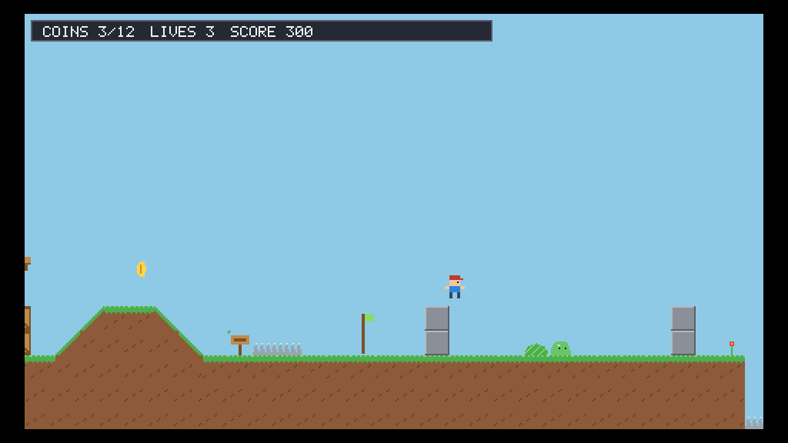
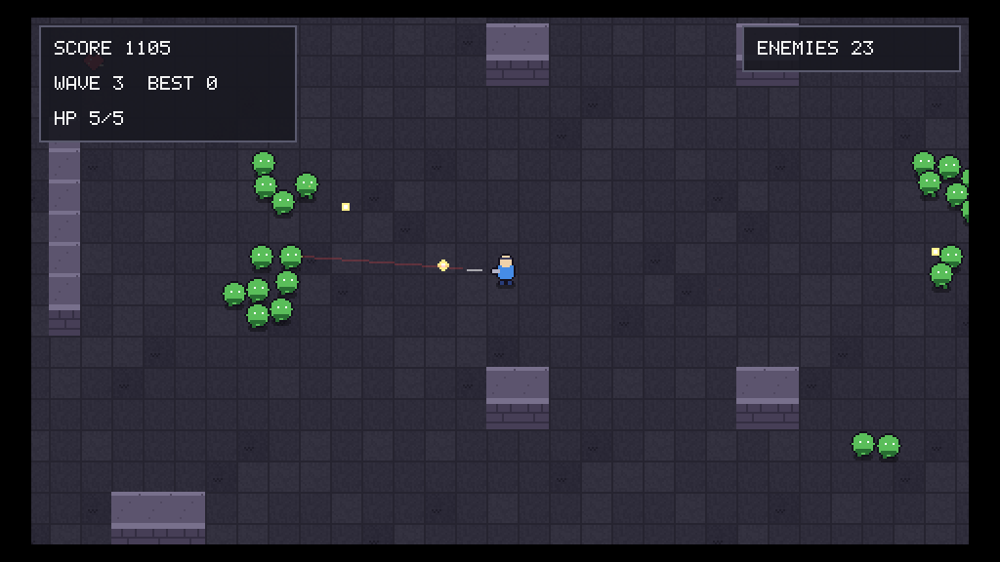
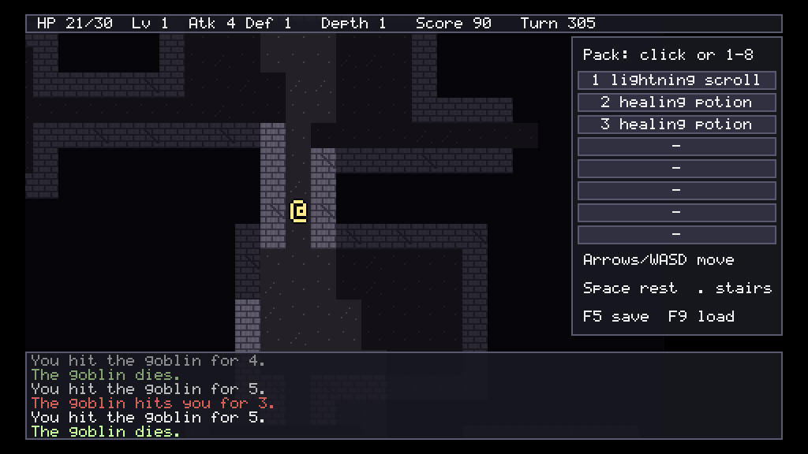
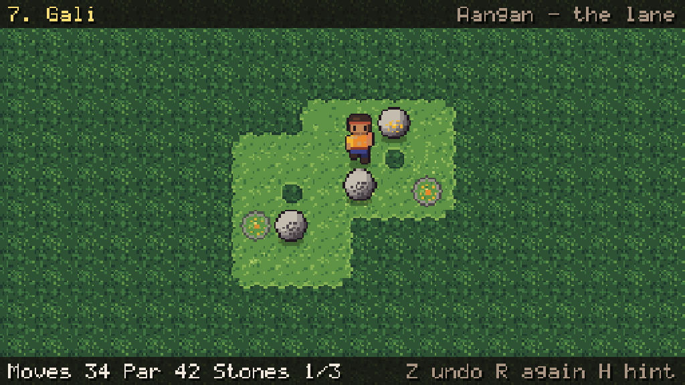
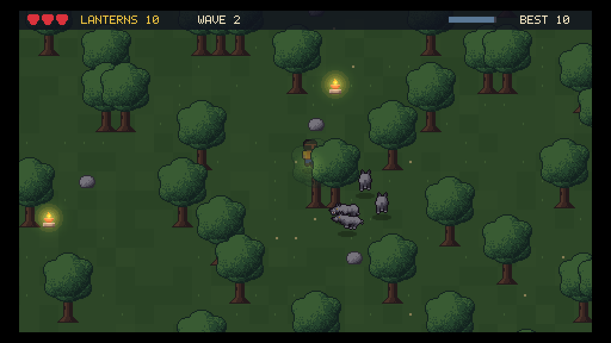
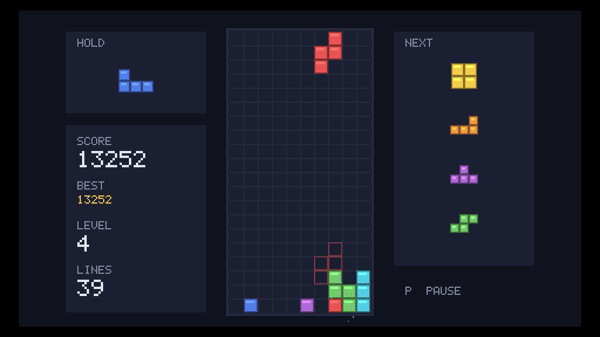
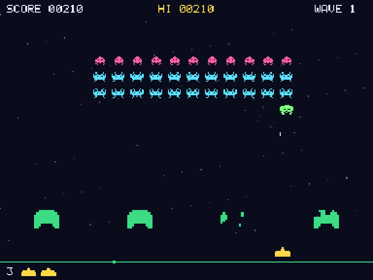
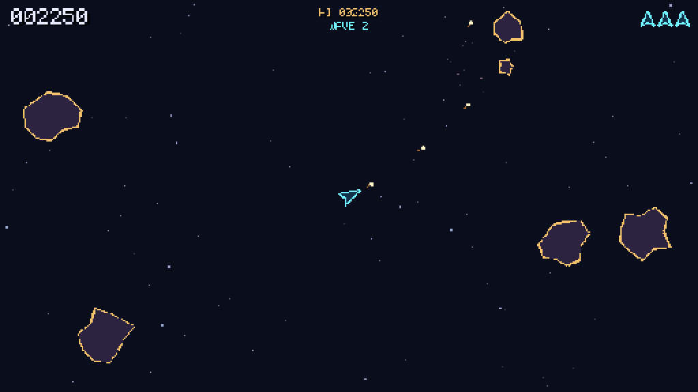
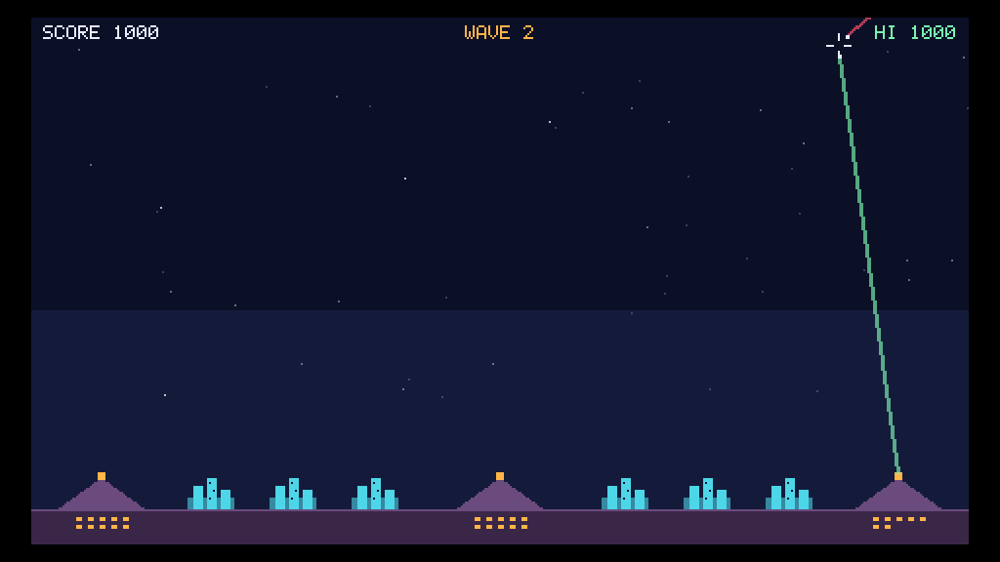

# LambdaEngine2D

[](https://github.com/devesh95official/LambdaEngine2D/actions)

A 2D engine for pixel-art games, written in C++20 on [raylib](https://www.raylib.com) 6.0. Game
state lives in an ECS world; game code is plain functions (systems) run in fixed stages of a
fixed-timestep loop. The simulation is deterministic: same binary, seed and input give the same
state hash, so games can record and replay input, run bots headless and check saves bit for bit.
raylib is confined to a few backend files; the rest is plain C++ and runs in tests without a window.

| | | |
|---|---|---|
|  |  |  |
|  |  |  |
|  |  |  |

## Start here

1. Build and run an example (see [Building](#building) below).
2. Read [docs/RECIPES.md](docs/RECIPES.md): a minimal game, common recipes and common mistakes.
3. Copy a template from `templates/` (or the closest game in `examples/`) and rename it.
4. Look up exact signatures in [docs/API_REFERENCE.md](docs/API_REFERENCE.md).

## Modules

| Module | What it has |
|---|---|
| math | `Vec2`, `Rect`, `Color`, shape tests, PCG32 streams, deterministic trig, easing, `Grid<T>` |
| core | `Result` errors, logging, string ids, `FixedString`, strict JSON, atomic writes, settings, profiler, debug overlay |
| ecs | generational entities, sparse-set pools, views, deferred commands, reflection, JSON prefabs, snapshots and undo, state hashing, hierarchy, turn scheduler |
| app | the `App` with twelve stages, plugins, multiple worlds, launch options (`--headless`, `--replay`, ...) |
| assets | typed `AssetServer` with scopes, dependencies, a worker thread and hot reload |
| render | sprites, y-sorting, cameras, pixel-perfect virtual screen, sort-keyed batching, atlases, text, shaders, 2D lights |
| physics | tile collision (slopes, one-way, ladders), colliders, rigid bodies, projectiles, platformer and top-down motors, queries, steering |
| input | named actions with saved bindings, latched per-tick input, key repeat, intents, record/replay, bot drivers |
| audio | sound banks with variants, streamed music, buses, crossfades, ducking, spatial mixing |
| scene | scene stack with fades, one world per scene, versioned saves and slots |
| tilemap | Tiled and native maps, autotiling, A*, Dijkstra maps, flow fields, FOV, grid movement, procgen |
| animation | Aseprite sheets, tick-exact animators, animation graphs, tweens |
| particles | pooled emitters, bursts from simulation code, weather presets |
| ui | retained widget tree, focus navigation, themes, toasts, message log, dialogue, stock menus |

## Examples

- [`examples/basics`](examples/basics): one small program per module, in learning order, from
  `01_skeleton` (the minimal game in [docs/RECIPES.md](docs/RECIPES.md)) to `14_scene`.
- [`examples/arcade`](examples/arcade/README.md): ten small games drawn with shapes (Invaders,
  Tetris, Frogger, 2048, ...), numbered by size, largest first.
- [`examples/games`](examples/games): seven bigger games, numbered by size, largest first:
  [Pathar](examples/games/01_pathar) (grid puzzle), [Roguelike](examples/games/02_roguelike),
  [Lantern Run](examples/games/03_lantern_run) (top-down chase),
  [Shooter](examples/games/04_shooter) (arena survival),
  [Apple Trail](examples/games/05_apple_trail) (snake), [Hop Hill](examples/games/06_platformer)
  (platformer) and [Breakout](examples/games/07_breakout).

Every game takes `--bot` (autoplay) and `--headless --bot --frames N`, which runs without a window
and prints a summary line ending in the final state hash. Starter projects for four genres are in
[`templates/`](templates).

## Building

You need a C++20 compiler (Apple clang, clang or GCC), CMake 3.28+ and Ninja. On macOS:
`xcode-select --install && brew install cmake ninja`.

Platforms: tested on macOS (Apple silicon). Linux is untested and Windows is not supported yet.

```bash
cmake --preset release
cmake --build --preset release
ctest --preset release -LE "gpu|bench"
build/release/examples/games/06_platformer/platformer
build/release/examples/games/06_platformer/platformer --headless --bot --frames 3000
```

Presets: `debug`, `release`, `relwithdebinfo`, `asan`, `ci` (warnings as errors) and `bench`, each
building into `build/<preset>/`. The first configure downloads raylib, nlohmann/json and doctest
and checks each archive's SHA-256. To build offline, put the same archives in a folder:

```bash
cmake --preset release -DLAM_DEPS_DIR=/path/to/deps
```

To use the engine in your own project, `add_subdirectory` it (or FetchContent) and create the game
with `lam_add_game`. The templates show the full setup.

## Performance

Release build, Apple M1:

| Benchmark | Result |
|---|---|
| 10k sprites (render bench) | ~0.9 ms per frame |
| 50k sprites | ~3.6 ms per frame, at most 7 draw calls |
| 10k physics bodies | ~1.1 ms per tick |
| 100k-entity ECS view | ~0.15 ms |
| A* on a 64x64 grid | under 0.1 ms, no allocation |

Steady-state ticks and frames don't allocate (each module's tests check this). Benchmarks build
with the `bench` preset (ctest label `bench`).

## Layout

```
cmake/            dependency pins and build helpers (lam_add_module, lam_add_game, ...)
src/<module>/     one static library per module; public headers in include/lam/<module>/
src/core/app/     the App, stages, plugins and worlds
tests/<module>/   one doctest executable per module
examples/         basics/ (module demos), arcade/ (small games), games/ (bigger games)
templates/        starter games to copy (platformer, top-down shooter, grid puzzle, roguelike)
tools/            gen_api_reference.py
docs/             guides and the API reference
```

## Documentation

- [docs/GUIDE.md](docs/GUIDE.md): how a frame runs, worlds and scenes, events, determinism rules.
- [docs/RECIPES.md](docs/RECIPES.md): a game skeleton, recipes for common tasks, common mistakes.
- [docs/API_REFERENCE.md](docs/API_REFERENCE.md): every public declaration, generated from the headers.
- `src/<module>/README.md`: usage, file formats and systems of each module.
- `templates/<genre>/README.md`: copying, building and growing a starter game.

## License

MIT, see [LICENSE](LICENSE). Third-party libraries are downloaded at configure time and keep
their own licences (raylib: zlib/libpng; nlohmann/json and doctest: MIT). See
[THIRD_PARTY.md](THIRD_PARTY.md).
